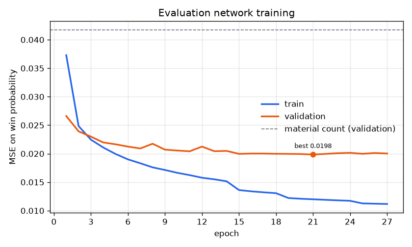

# Python chess engine: material vs. neural-network evaluation

An alpha-beta chess engine built on python-chess move generation, with two
interchangeable evaluators: a hand-tuned material count (the baseline) and a
small PyTorch network trained on one million Stockfish-labelled positions from
Lichess games. A Zobrist-keyed LRU evaluation cache recovers part of the
network's speed cost, and a self-play match measures which evaluator plays
better at a fixed time per move.

**Live demo: [neural-chess-engine.vercel.app](https://neural-chess-engine.vercel.app)**. Play against the engine in your browser.

**Results at a glance** (details in [Results](#results); every number comes from a file in `results/`):

* The network predicts Stockfish evaluations far better than a material count:
  validation MSE on win probability 0.020 vs. 0.042, MAE 156 cp vs. 229 cp.
* Inside the search it costs speed. Nodes per second drop 3.2x (80k → 25k)
  and the average completed depth at 1 s/move falls from 5.2 to 3.9. About two
  thirds of the NN engine's time goes to network calls (~50 µs each).
* The Zobrist LRU cache hits 60% of lookups when it persists across moves. It
  raises NN nodes/sec by 57%, cuts network calls per move by 41%, and lifts
  depth from 3.9 to 4.2.
* In self-play, NN + cache beats the material baseline **+73 =21 −6 (83.5%),
  an Elo difference of +282 ± 75** (95% CI), over 100 games at 0.5 s/move.
  It wins while searching a full ply shallower: evaluation quality outweighs
  depth here.

## Architecture

```
chess_engine/
  search.py       negamax alpha-beta, iterative deepening, time control, quiescence, move ordering
  evaluators.py   Evaluator interface, MaterialEvaluator, NNEvaluator, CachedEvaluator
  encoding.py     board -> 781 side-to-move-relative features (and a 98-byte packed form)
  model.py        PyTorch MLP and checkpoint save/load
  zobrist.py      fast Polyglot Zobrist hashing (cache keys)
  positions.py    fixed benchmark positions (4 opening, 4 middlegame, 4 endgame)
  openings.py     50-opening book for self-play
  reporting.py    Markdown/JSON helpers
scripts/
  build_dataset.py   Lichess .pgn.zst -> sampled positions -> Stockfish labels -> packed dataset
  train.py           train the network, save the best checkpoint, log and plot losses
  depth_benchmark.py depth / nodes per second / evaluations per move at a fixed time per move
  profile_search.py  where does search time go? (wall-clock timers + cProfile)
  match.py           self-play match with an Elo estimate
  play.py            play against the engine in the terminal
  export_weights.py  export the network to numpy (models/nn_eval.npz) for the web demo
  serve_demo.py      run the web demo locally
api/
  move.py            Vercel serverless function: the engine's reply to a position
public/              web demo: board UI (index.html, app.js, style.css, pieces/)
data/       raw and processed data (gitignored)
models/     trained checkpoint (nn_eval.pt) and its numpy export (nn_eval.npz)
results/    metrics, profiles, PGNs, plots
tests/      pytest suite (105 tests)
config.py   every default; overridden by config.toml, then by command-line flags
```

**Search** (`search.py`). Fail-soft negamax alpha-beta with iterative
deepening. The clock is checked every 16 nodes. When time runs out the
unfinished iteration is discarded and the best move of the last *completed*
depth is returned. Depth 1 is never interrupted, so a legal move always
exists. A quiescence search over captures and queen promotions resolves the
horizon; it searches all evasions when in check and goes at most 8 plies deep.

Moves are ordered as follows:
1. The previous iteration's principal-variation move at each ply.
2. Captures, by MVV-LVA (most valuable victim, then least valuable attacker).
3. Queen promotions.
4. Checking moves. These are detected with precomputed attack masks rather
   than `Board.gives_check`, which pushes and pops the move.
5. Quiet moves.

Inside the tree, a repeated position (checked against a key stack that
includes the game history), the fifty-move rule and insufficient material
score as draws. Mate scores are `MATE_SCORE - ply`, so faster mates score
higher. Every search reports nodes, quiescence nodes, leaf evaluations and
network calls.

**Evaluators** (`evaluators.py`). Every evaluator provides
`evaluate(board) -> centipawns for the side to move`. The base class applies
the rules first (checkmate, stalemate, insufficient material, fifty-move rule,
threefold repetition) and only then calls the subclass's `static_eval`:

* `MaterialEvaluator`: P=100, N=320, B=330, R=500, Q=900 (configurable).
* `NNEvaluator`: encodes the board into a reused buffer and runs the MLP under
  `torch.inference_mode()` with one thread. It converts the win-probability
  logit back to centipawns (`cp = logit * 400/ln 10`), clipped to ±2000.
* `CachedEvaluator`: wraps any evaluator's `static_eval` in an `OrderedDict`
  LRU keyed by the 64-bit Polyglot Zobrist hash (500k entries by default).
  Rule-based scores are never cached, because they depend on history and ply.
  The cache persists across moves until `new_game()` clears it. It tracks
  hits, misses and evictions. `zobrist.py` computes the same keys as
  `chess.polyglot.zobrist_hash` about 2x faster (3 µs vs 7 µs).

**Features** (`encoding.py`). 781 inputs, from the side to move's perspective
(the board is flipped vertically when Black is to move):
* 12×64 one-hot piece-square planes, side to move's pieces first;
* a side-to-move bit;
* 4 castling bits (ours/theirs × kingside/queenside);
* 8 en-passant-file bits, set only when an en-passant capture is legal.

The dataset stores each position in 98 bytes (12 bitboards plus the extra bits).

**Network** (`model.py`). 781 → 256 → 32 → 1 with ReLU (208,449 parameters).
It outputs the logit of the side to move's win probability.

**Dataset** (`scripts/build_dataset.py`). Three stages, each resumable:
1. **Sample.** Stream the `.pgn.zst` through `zstandard` and
   `io.TextIOWrapper`; nothing is decompressed to disk. A custom PGN visitor
   that never builds a game tree skips the first 10 plies, positions in check,
   and positions whose game move was a capture. It then reservoir-samples up
   to 6 positions per game and deduplicates on the FEN without move counters,
   stopping at the target count.
2. **Label.** Run Stockfish at depth 10 in parallel worker processes, one
   engine per process. Scores are taken from the side to move's perspective;
   mates become ±10000, then everything is clipped to ±2000 cp. Labels are
   appended as they arrive, and a rerun skips positions already labelled.
3. **Pack.** Encode the labelled positions into `data/processed/dataset.npz`.

**Training** (`scripts/train.py`). The target is `p = sigmoid(cp / 173.7)` (the
Elo logistic curve). The loss is the MSE between `sigmoid(logit)` and `p`,
which keeps already-decisive evaluations from dominating. Training uses AdamW
(lr 1e-3, batch 1024), halves the LR after 2 stagnant epochs, holds out a 5%
validation split, stops early after 6 stagnant epochs, and keeps the best
checkpoint.

**Match** (`scripts/match.py`). 50 book openings, each played once with each
colour. Both engines get the same fixed time per move. Games are adjudicated
by python-chess (checkmate, stalemate, insufficient material, 75-move and
fivefold rules, with threefold repetition and the fifty-move rule claimed
automatically), plus a move cap scored as a draw. Every game is appended to
`results.jsonl` and `games.pgn` with per-move depth/score comments, so a run
resumes after an interruption. `--workers N` plays games in parallel and
warns that this changes search depth. `--quick` is a 4-game smoke test. The
script prints an estimated duration before starting. The summary reports W/D/L,
score, an Elo difference with a 95% margin, and the likelihood of superiority.

## Setup

```bash
python -m venv .venv
.venv/Scripts/activate              # Windows; `source .venv/bin/activate` on Linux/macOS
pip install -r requirements.txt
cp config.example.toml config.toml  # then set [stockfish].path
pytest
```

Stockfish is only needed for `build_dataset.py`. If `[stockfish].path` is unset
or points to a missing file, the script stops and explains how to fix it.
Every parameter in `config.py` can be overridden in a `config.toml` section
(`[search]`, `[material]`, `[nn]`, `[cache]`, `[stockfish]`, `[dataset]`,
`[train]`, `[benchmark]`, `[match]`). Unknown keys are rejected, and
command-line flags take precedence.

## Play against it

```bash
python scripts/play.py                          # you are White vs. NN + cache at 1 s/move
python scripts/play.py --color black --time 3   # stronger: more time per move
python scripts/play.py --engine material        # the material baseline instead
```

Enter moves as `e4`, `Nf3`, `O-O`, `exd5`, `e8=Q` (or UCI `e2e4`). Commands:
`moves`, `undo`, `hint`, `flip`, `resign`, `quit`. The game's PGN is printed at the end.

## Web demo

Live at **https://neural-chess-engine.vercel.app**, deployed from this repository's `main` branch.

The page is static (`public/`). The board, move input and rules run in the
browser with chess.js. Each engine move is a `POST /api/move` to a Vercel
Python function (`api/move.py`) that runs the same search code. PyTorch is far
too large for a serverless function, so the function uses `NumpyNNEvaluator`.
It's the same trained network, exported by `scripts/export_weights.py` and
evaluated with numpy. The export gives identical scores (0 cp difference over
500 random positions). It is also faster: 14.6 µs per evaluation vs 33.3 µs
with PyTorch, because the first layer only sums the weight columns of the
~30 active inputs.

Run it locally:

```bash
python scripts/export_weights.py   # only needed after retraining
python scripts/serve_demo.py       # http://localhost:8000
```

Deployment: the repository root is the Vercel project (framework preset
"Other", no build command). `vercel.json` configures the function,
`api/requirements.txt` lists its only dependencies (python-chess and numpy),
`.python-version` selects Python 3.13, and `.vercelignore` leaves out training
data, results and the PyTorch requirements. A link like
`/#fen=6k1/5ppp/8/8/8/8/5PPP/3R2K1_w_-_-_0_1` starts the board from any
position (`_` stands for spaces).

## Reproducing each phase

The results below were produced on an 8-core AMD Ryzen 7 9800X3D (Windows 11,
Python 3.13, CPU-only PyTorch) with Stockfish 19.

**Phase 1: search core and material baseline**
```bash
pytest tests/test_search.py tests/test_evaluators.py
python scripts/depth_benchmark.py --evaluators material --time 1.0
```

**Phase 2: dataset and network** (~4 min sampling, ~27 min labelling with 7
workers, ~1 min packing, ~2 min training)
```bash
# lichess_db_standard_rated_2014-01.pgn.zst (111 MB) from https://database.lichess.org/
python scripts/build_dataset.py data/raw/lichess_db_standard_rated_2014-01.pgn.zst --target 1000000
python scripts/train.py
```

**Phase 3: NN in the search, profile, cache**
```bash
python scripts/depth_benchmark.py --evaluators material nn nn-cache --time 1.0
python scripts/profile_search.py --evaluators material nn nn-cache --time 5
```

**Phase 4: self-play match**
```bash
python scripts/match.py --quick                 # 4 short games to check the pipeline
python scripts/match.py --games 100 --time 0.5 --workers 4
```

## Results

### Dataset (`results/dataset_summary.json`)

1,000,000 unique positions sampled from 176,190 games of the January 2014
Lichess rated database and labelled by Stockfish 19 at depth 10.

| statistic | value |
| --- | --- |
| label mean / std (side to move) | +62 cp / 561 cp |
| median abs(label) | 246 cp |
| mate scores / clipped at ±2000 | 21,332 / 2.2% |
| positions with 26-32 / 13-25 / 2-12 pieces | 48% / 43% / 8% |

The positive mean is plausibly the side to move's tempo advantage; it is
left uncorrected.

### Training (`results/train_metrics.json`, `results/train_loss.png`)

| predictor (validation set, 50k positions) | MSE on win probability | MAE vs. Stockfish |
| --- | ---: | ---: |
| constant (mean) | 0.1134 | – |
| material count (the baseline evaluator) | 0.0417 | 229 cp |
| **network, best epoch (21 of 27)** | **0.0198** | **156 cp** |



Training took under 2 minutes on the CPU. The train/validation gap (0.012 vs.
0.020) shows the network starting to memorise; more data would likely help
more than more epochs.

### Depth benchmark (`results/depth_comparison.md`, `results/depth_*.json`)

1 second per move. 12 positions (4 opening, 4 middlegame, 4 endgame); from
each one the engine plays 3 consecutive moves against itself, keeping its
cache.

| config | depth (all) | depth open/mid/end | nodes/sec | evals/move | net calls/move | cache hit rate |
| --- | ---: | --- | ---: | ---: | ---: | ---: |
| material | 5.22 | 4.4 / 4.0 / 7.2 | 80,159 | 44,598 | 0 | – |
| nn | 3.92 | 3.2 / 3.2 / 5.3 | 24,928 | 13,686 | 13,677 | – |
| nn-cache | 4.17 | 3.4 / 3.2 / 5.8 | 39,120 | 20,425 | 8,054 | 60.5% |

Swapping in the network costs about 1.3 plies: nodes per second drop 3.2x.
The cache recovers 57% of nodes per second and cuts network calls per move by
41%. Its value grows as it persists. The hit rate is 48.5% on the first move
from a position, 61.3% on the second and 69.5% on the third. It also depends
on the phase: 83% in endgames, where nodes/sec doubles, against 42-43% in
openings and middlegames (+16-28%). Most of the gain shows in endgames, where
the extra speed buys half a ply.

### Profile (`results/profile_summary.md`, `results/profile_*.txt`)

A 5-second search of the closed Ruy Lopez middlegame, timed around the evaluator:

| evaluator | nodes/sec | time in evaluate() | time in static eval / network | µs per eval | nodes/sec if eval were free |
| --- | ---: | ---: | ---: | ---: | ---: |
| material | 74,259 | 26.7% | 4.9% | 5.7 | 101,363 |
| nn | 18,709 | 73.1% | 64.7% | 57.7 | 69,644 |
| nn-cache (single search, cold cache) | 23,103 | 72.3% | 54.4% | 47.5 | 83,310 |

Network calls are the bottleneck: about 50 µs per call, of which roughly
10 µs is encoding and the rest the PyTorch forward pass (three `Linear` layers
plus `nn.Module` call overhead). Together they take two thirds of the NN
engine's time. The rest of the search costs 10-13 µs per node in every configuration.
For the material engine the rules check (detecting mate and stalemate needs a
legal-move probe) costs more than the material count itself. The cProfile
breakdowns are in `results/profile_*.txt`.

### Self-play match (`results/match/summary.md`, `results/match/games.pgn`)

100 games (50 openings × 2 colours) at 0.5 s/move with a 200-ply cap, 4 games
in parallel, ~22 minutes in total.

| engine A | W | D | L | score | Elo diff (A − B) | 95% CI | LOS |
| --- | ---: | ---: | ---: | ---: | --- | --- | ---: |
| nn-cache | 73 | 21 | 6 | 83.5% | +282 ± 75 | [+218, +367] | >99.9% |

| engine (measured during the match, 4 parallel games) | avg depth | nodes/sec | evals/move | net calls/move | cache hit rate |
| --- | ---: | ---: | ---: | ---: | ---: |
| nn-cache | 2.95 | 23,865 | 6,628 | 4,206 | 35.6% |
| material | 4.00 | 60,417 | 17,191 | 0 | – |

* NN + cache scored 33 W / 15 D / 2 L as White and 40 W / 6 D / 4 L as Black.
  79 games ended in checkmate, 18 at the move cap and 3 by threefold
  repetition. The average game lasted 115 plies.
* The network wins mostly by attacking the king. The material engine has no
  notion of development or king safety, so with no material at stake it
  shuffles pieces (e.g. `Rg1 Rh1 Ke2 Kf1` in round 2) while the network builds
  a mating attack. Its extra ply of search sometimes wins material, but that
  rarely turns into a win (see the next point).
* The move cap tends to favour the baseline. At the cap, the material engine
  was at least 3 pawns ahead in 8 of the 18 games and the network in 3, with 7
  level. Neither engine has mating technique beyond its 3-5 ply horizon. A
  material count cannot tell a mating net from any other position with the
  same material, and the network's evaluation saturates near ±2000 cp in won
  positions, so neither has anything pulling it towards the mate.
* The in-game cache hit rate (36%) is lower than in the depth benchmark (60%):
  searches are shallower at 0.5 s/move, and most positions are middlegames,
  where hit rates are lowest.

## Notes and limitations

* Pure Python is slow: the engine searches about 80k nodes/s with the material
  evaluator, so even at depth 4-5 it is far weaker than a real engine. The
  comparison between evaluators is the point, not absolute strength.
* The material baseline knows nothing about piece placement, so the opening
  moves it chooses among equal-material options are arbitrary.
* The Elo margin uses the per-game (trinomial) score variance. Each opening is
  played with both colours, so game pairs are correlated; a pentanomial
  (game-pair) estimate would usually be somewhat tighter. Parallel games share the CPU; the match
  records the nodes per second each engine actually reached.
* Further speed-ups for the NN path that this project does not implement:
  incremental (NNUE-style) first-layer updates, calling the layers'
  functional ops directly to avoid `nn.Module` overhead, and a transposition
  table, which would also reuse search results, not just evaluations.
